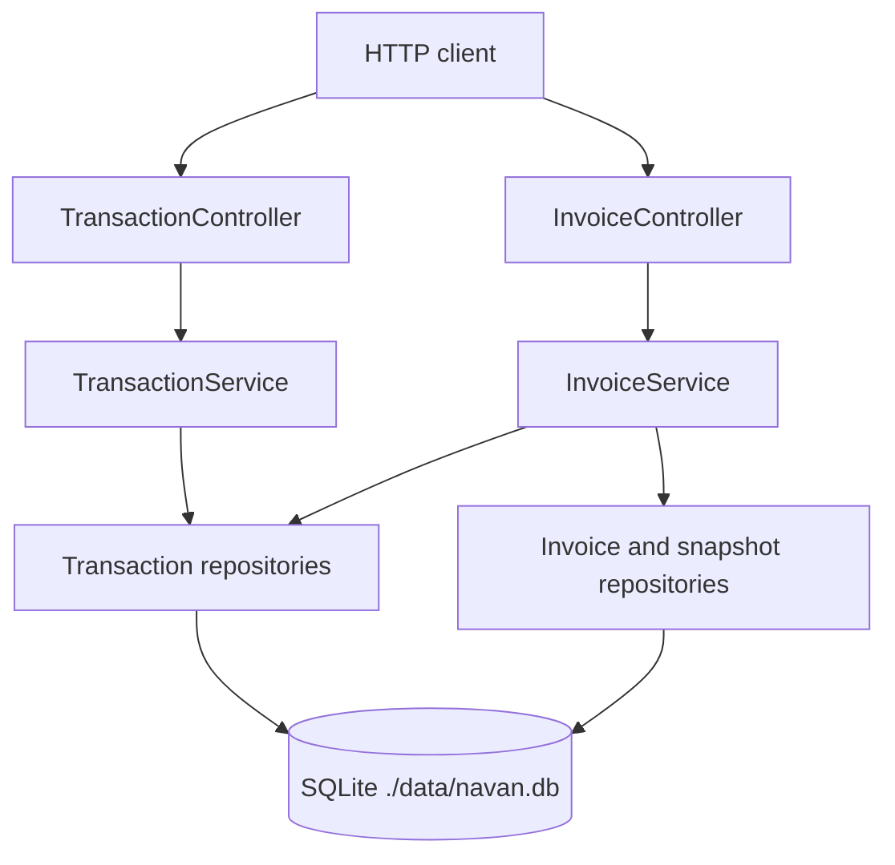
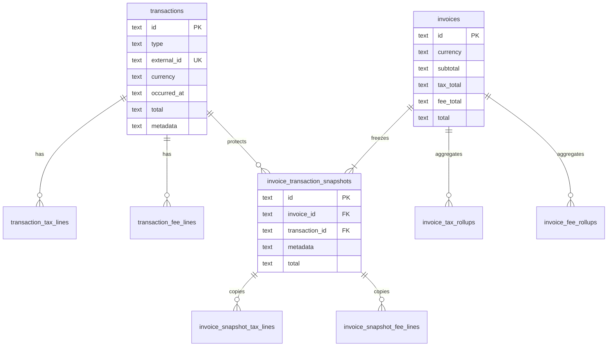
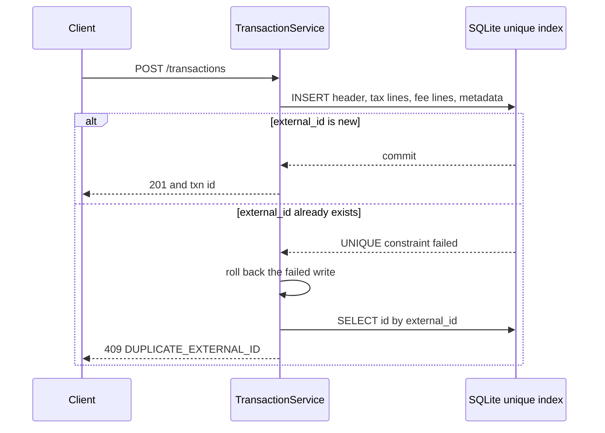
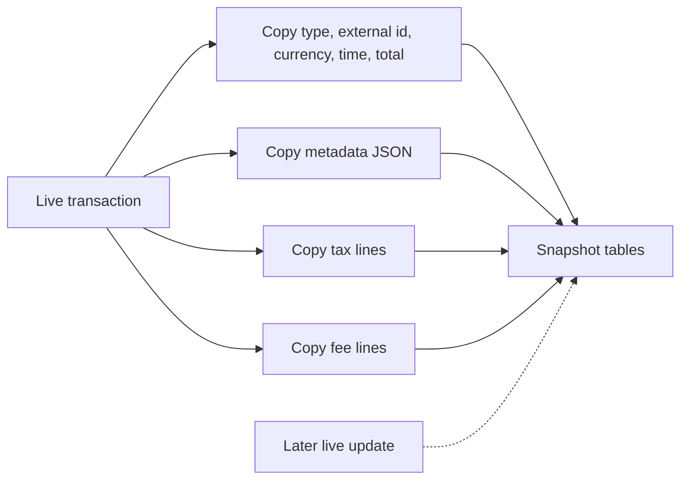
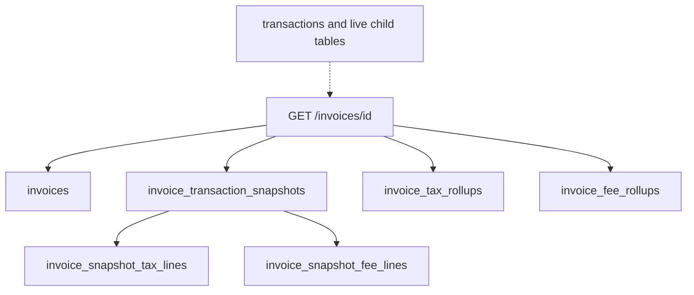
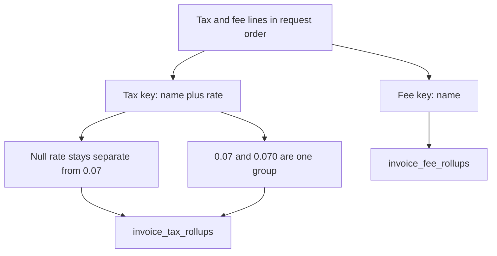
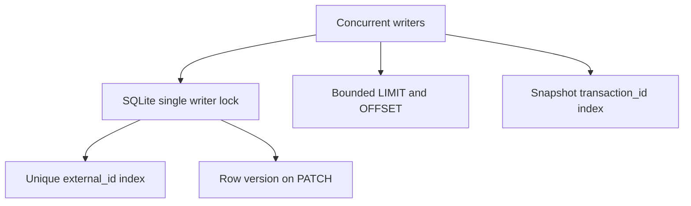

# Architecture

The service is one Spring Boot process. Controllers bind HTTP and status codes. `TransactionService` and `InvoiceService` own validation, `BigDecimal` math, and database transaction boundaries. Repositories persist rows in the SQLite file `./data/navan.db`. JSON uses snake_case.

## Request path

| Component | Responsibility |
| --- | --- |
| `TransactionController` | `POST`, `GET`, `PATCH`, `DELETE`, and paginated `GET /transactions` |
| `InvoiceController` | `POST`, `GET`, `PATCH`, `DELETE`, and paginated `GET /invoices` |
| `TransactionService` | Type metadata checks, money normalization, atomic child replacement, duplicate `external_id` handling |
| `InvoiceService` | Invoice composition checks, snapshot copy, tax and fee rollups, atomic invoice replacement |
| `MetadataValidator` | Required fields for `flight`, `hotel`, `rail`, and `navan_fee` |
| Repositories | Inserts, id lookups, existence checks, and `LIMIT` / `OFFSET` id pages |
| `ApiExceptionHandler` | Consistent 400, 404, and 409 JSON bodies |
| SQLite | Unique constraint, foreign keys, indexes, and the single-writer lock |

## Data model

Live transactions and invoice snapshots are separate table families. Invoice GET reads the snapshot family only.

| Relationship | Cardinality | Delete behavior |
| --- | --- | --- |
| `transactions` to `transaction_tax_lines` | one to many | `ON DELETE CASCADE` |
| `transactions` to `transaction_fee_lines` | one to many | `ON DELETE CASCADE` |
| `invoices` to `invoice_transaction_snapshots` | one to many | `ON DELETE CASCADE` |
| `invoices` to `invoice_tax_rollups` | one to many | `ON DELETE CASCADE` |
| `invoices` to `invoice_fee_rollups` | one to many | `ON DELETE CASCADE` |
| `invoice_transaction_snapshots` to `invoice_snapshot_tax_lines` | one to many | `ON DELETE CASCADE` |
| `invoice_transaction_snapshots` to `invoice_snapshot_fee_lines` | one to many | `ON DELETE CASCADE` |
| `transactions` to `invoice_transaction_snapshots` | one to many | `ON DELETE RESTRICT` |

Tax lines and fee lines stay in their own tables so they can be indexed, replaced, and rolled up without parsing the metadata document. Metadata keeps the type-specific structure, including flight coupons, the hotel address, rail legs, and the Navan fee kind. The service validates that document before insert and stores it whole, so GET returns the same structure.

### `transactions`

| Column | Type | Constraint | Role |
| --- | --- | --- | --- |
| `id` | TEXT | primary key | Server id, prefixed `txn_` |
| `type` | TEXT | `flight`, `hotel`, `rail`, or `navan_fee` | Selects metadata validation |
| `external_id` | TEXT | not null, unique index | Client reference |
| `currency` | TEXT | length 3 | ISO code, stored uppercase |
| `occurred_at` | TEXT | not null | ISO-8601 instant |
| `total` | TEXT | not null | Gross amount, scale 2 |
| `metadata` | TEXT | not null | Validated JSON object |
| `created_at` | TEXT | not null | Insert time |
| `updated_at` | TEXT | not null | Last successful write |
| `version` | INTEGER | not null | Optimistic lock |

### `transaction_tax_lines`

| Column | Type | Constraint | Role |
| --- | --- | --- | --- |
| `id` | TEXT | primary key | Line id |
| `transaction_id` | TEXT | not null, foreign key | Parent transaction |
| `name` | TEXT | not null | Tax name used in rollups |
| `rate` | TEXT | nullable | Null is its own rollup group |
| `amount` | TEXT | not null | Scale 2 |
| `line_order` | INTEGER | not null | Request order |

### `transaction_fee_lines`

| Column | Type | Constraint | Role |
| --- | --- | --- | --- |
| `id` | TEXT | primary key | Line id |
| `transaction_id` | TEXT | not null, foreign key | Parent transaction |
| `name` | TEXT | not null | Fee name used in rollups |
| `amount` | TEXT | not null | Scale 2 |
| `line_order` | INTEGER | not null | Request order |

### `invoices`

| Column | Type | Constraint | Role |
| --- | --- | --- | --- |
| `id` | TEXT | primary key | Server id, prefixed `inv_` |
| `currency` | TEXT | length 3 | Shared currency of the included transactions |
| `subtotal` | TEXT | not null | `total - tax_total - fee_total` |
| `tax_total` | TEXT | not null | Sum of tax rollup amounts |
| `fee_total` | TEXT | not null | Sum of fee rollup amounts |
| `total` | TEXT | not null | Sum of snapshot transaction totals |
| `created_at` | TEXT | not null | Insert time |
| `updated_at` | TEXT | not null | Last successful replacement |
| `version` | INTEGER | not null | Optimistic lock |

### `invoice_transaction_snapshots`

| Column | Type | Constraint | Role |
| --- | --- | --- | --- |
| `id` | TEXT | primary key | Snapshot id |
| `invoice_id` | TEXT | not null, foreign key, cascade | Parent invoice |
| `transaction_id` | TEXT | not null, foreign key, restrict | Original live transaction |
| `type` | TEXT | not null | Copied type |
| `external_id` | TEXT | not null | Copied client reference |
| `currency` | TEXT | not null | Copied currency |
| `occurred_at` | TEXT | not null | Copied occurrence time |
| `total` | TEXT | not null | Copied gross total |
| `metadata` | TEXT | not null | Copied JSON, not a live join |
| `snapshot_order` | INTEGER | not null | Request order |

### Snapshot child tables and rollups

| Table | Parent | Columns beyond id and parent |
| --- | --- | --- |
| `invoice_snapshot_tax_lines` | `snapshot_id` | `name`, nullable `rate`, `amount`, `line_order` |
| `invoice_snapshot_fee_lines` | `snapshot_id` | `name`, `amount`, `line_order` |
| `invoice_tax_rollups` | `invoice_id` | `name`, nullable `rate`, `amount`, `line_order` |
| `invoice_fee_rollups` | `invoice_id` | `name`, `amount`, `line_order` |

Header, tax lines, fee lines, and metadata are written in one database transaction. If metadata validation fails, no header row is inserted.

## Type-specific metadata

Unknown types, unknown Navan fee kinds, and missing required fields return 400. An empty metadata object is rejected.

| Type | Required fields | Optional fields | Collection rule |
| --- | --- | --- | --- |
| `flight` | `origin`, `destination`, `fare`, `coupons` | Extra keys are kept | `coupons` may be empty |
| `hotel` | `name`, `address.street`, `address.city`, `address.country`, `check_in`, `check_out`, `nights`, `room_rate_per_night` | `extras` and other keys are kept | `check_out` cannot be before `check_in` |
| `rail` | `legs` | `train_number` and `class` on each leg | At least one leg |
| `navan_fee` | `fee_kind` | `description`, `related_external_id` | `fee_kind` is `trip_fee` or `agent_call_fee` |

### Flight coupon

| Field | Required | Example |
| --- | --- | --- |
| `flight_number` | yes | `BA982` |
| `from` | yes | `TXL` |
| `to` | yes | `LHR` |
| `departure` | yes | `2026-03-11T07:00:00Z` |
| `arrival` | yes | `2026-03-11T08:20:00Z` |
| `carrier` | no | `BA` |

### Rail leg

| Field | Required | Example |
| --- | --- | --- |
| `origin` | yes | `London St Pancras` |
| `destination` | yes | `Lille Europe` |
| `departure` | yes | `2026-03-13T09:00:00Z` |
| `arrival` | yes | `2026-03-13T10:30:00Z` |
| `train_number` | no | `EST9108` |
| `class` | no | `standard` |

### Hotel address

| Field | Required | Example |
| --- | --- | --- |
| `name` | yes | `Hotel Mitte London` |
| `address.street` | yes | `12 Kingsway` |
| `address.city` | yes | `London` |
| `address.country` | yes | `GB` |
| `check_in` | yes | `2026-03-11` |
| `check_out` | yes | `2026-03-13` |
| `nights` | yes | `2` |
| `room_rate_per_night` | yes | `140.00` |

## Duplicate `external_id`

`ux_transactions_external_id` is the source of truth. The service inserts and flushes. It does not check-then-insert, and it does not take an in-process lock.

| Outcome | HTTP | Error code | Rows written |
| --- | --- | --- | --- |
| New `external_id` | 201 | none | 1 header plus its children |
| Same `external_id`, including a concurrent POST | 409 | `DUPLICATE_EXTERNAL_ID` | The original row only |
| `SQLITE_BUSY` while the winner holds the write lock | retried, then 201 or 409 | none, or `DUPLICATE_EXTERNAL_ID` | 1 row |

WAL mode and `busy_timeout=10000` let the losing insert wait, then fail the unique check. Ids are random `txn_` and `inv_` values, not row counts. The 409 body includes `existing_transaction_id`.

## Invoice snapshots

An invoice is a frozen copy of the transactions selected at create or replace time. Later edits to live rows do not flow into that copy.

`GET /invoices/{id}` reads the right-hand side of that diagram.

The copied `transaction_id` is only a pointer for the "is this transaction invoiced?" check. Amounts, metadata, taxes, and fees on the invoice response come from snapshot columns.

| Step | Create and successful PATCH | Failed create or PATCH |
| --- | --- | --- |
| 1 | Require `transaction_id`, `transaction_ids`, or both | 400 when no id is present |
| 2 | Trim ids and reject blanks | 400 |
| 3 | Reject a repeated id | 409 `DUPLICATE_TRANSACTION_IDS`, no write |
| 4 | Load every id | 404 `TRANSACTION_NOT_FOUND` if any id is missing, no write |
| 5 | Require one currency | 409 `MIXED_CURRENCY`, no write |
| 6 | Copy headers, metadata, tax lines, and fee lines | Previous invoice contents stay when this step fails |
| 7 | Build tax rollups and fee rollups | Rolled back with step 6 |
| 8 | Store `subtotal`, `tax_total`, `fee_total`, and `total` | One database commit for the whole invoice |

`PATCH /invoices/{id}` runs steps 1 through 5 before it deletes the old snapshot and rollup rows. Validation failure leaves the previous invoice intact. The delete and insert then share one database transaction.

`DELETE /invoices/{id}` removes the invoice. Cascade removes snapshots, snapshot lines, and rollups. Live transactions remain. A transaction with no remaining snapshot row can be patched or deleted.

## Totals and rollup grouping

Amounts are `BigDecimal` values stored as decimal text. Input amounts use scale 2 and `RoundingMode.HALF_UP`. Rates keep up to 6 decimal places, with trailing zeros removed. Null rate stays null.

| Figure | Formula | Seed result |
| --- | --- | --- |
| `total` | Sum of included transaction totals | EUR 685.70 |
| `tax_total` | Sum of tax rollup amounts | EUR 36.70 |
| `fee_total` | Sum of fee rollup amounts | EUR 29.00 |
| `subtotal` | `total - tax_total - fee_total` | EUR 620.00 |

Tax and fee amounts are already inside each gross transaction total, so rollups are not added to `total` again.

| Included transaction | Amount |
| --- | --- |
| Flight `flight-TXL-LHR-2026-03-11` | 220.00 |
| Hotel `hotel-LON-2026-03-11` | 331.70 |
| Rail `rail-STP-PAR-2026-03-13` | 94.00 |
| Navan trip fee | 25.00 |
| Navan agent call fee | 15.00 |
| Grand total | 685.70 |

| Rollup | Group key | Seed rows |
| --- | --- | --- |
| Tax | `name` and `rate`; null rate is its own group | Airport tax 15.00 with no rate; VAT 21.70 at 0.07 |
| Fee | `name` only | YQ 25.00; Booking fee 4.00 |

Group order follows the first time that key appears. The two Navan fees have empty `fee_lines`. They still appear as transaction snapshots. Their totals are part of the 685.70 and are not extra fee-rollup rows.

## API behavior

| Method | Path | Success | Conflict or missing data |
| --- | --- | --- | --- |
| `POST` | `/transactions` | 201 stored transaction | 409 duplicate `external_id`; 400 invalid body or metadata |
| `GET` | `/transactions/{id}` | 200 transaction with metadata, taxes, and fees | 404 `TRANSACTION_NOT_FOUND` |
| `GET` | `/transactions` | 200 page | 400 `INVALID_PAGINATION` |
| `PATCH` | `/transactions/{id}` | 200 replaced fields and child lists | 409 `TRANSACTION_INVOICED` or `CONCURRENT_MODIFICATION`; 404 when missing |
| `DELETE` | `/transactions/{id}` | 204, children cascade | 409 `TRANSACTION_INVOICED`; 404 when missing |
| `POST` | `/invoices` | 201 invoice and snapshots | 409 repeated ids or mixed currency; 404 missing transaction |
| `GET` | `/invoices/{id}` | 200 snapshot body | 404 `INVOICE_NOT_FOUND` |
| `GET` | `/invoices` | 200 page | 400 `INVALID_PAGINATION` |
| `PATCH` | `/invoices/{id}` | 200 rebuilt snapshots and rollups | Failed validation leaves the old invoice |
| `DELETE` | `/invoices/{id}` | 204 snapshots and rollups removed | 404 when missing; transactions stay |

`PATCH /transactions/{id}` can change `total`, `tax_lines`, `fee_lines`, `metadata`, and `occurred_at`. Sending `type`, `external_id`, or `currency` is rejected as an unknown field. A provided child list replaces the stored list in the same database transaction.

## Pagination, indexes, and contention

| Query parameter | Default | Accepted | Rejected |
| --- | --- | --- | --- |
| `limit` | 50 | 1 through 100 | Below 1 or above 100, including `limit=1000`, returns 400 |
| `offset` | 0 | 0 or greater | Negative offset returns 400 |

Both list endpoints order in the database and apply `LIMIT` / `OFFSET` there. Transactions use `occurred_at DESC, id DESC`. Invoices use `created_at DESC, id DESC`. The service does not load a table and slice it in memory. `limit=1000` is rejected rather than silently reduced to 100.

| Index | Columns | Used for |
| --- | --- | --- |
| Primary key on `transactions` | `id` | Transaction GET, PATCH, DELETE |
| `ux_transactions_external_id` | `external_id` | One row per client reference; concurrent POST winner |
| `ix_transactions_occurred_at` | `occurred_at, id` | Transaction list order |
| `ix_transaction_tax_lines_transaction_id` | `transaction_id` | Tax lines for one transaction |
| `ix_transaction_fee_lines_transaction_id` | `transaction_id` | Fee lines for one transaction |
| Primary key on `invoices` | `id` | Invoice GET, PATCH, DELETE |
| `ix_invoices_created_at` | `created_at, id` | Invoice list order |
| `ix_invoice_snapshots_transaction_id` | `transaction_id` | Invoice membership check |
| `ix_invoice_snapshots_invoice_id` | `invoice_id` | Snapshots for one invoice |
| `ix_invoice_snapshot_tax_lines_snapshot_id` | `snapshot_id` | Copied tax lines |
| `ix_invoice_snapshot_fee_lines_snapshot_id` | `snapshot_id` | Copied fee lines |
| `ix_invoice_tax_rollups_invoice_id` | `invoice_id` | Tax rollups |
| `ix_invoice_fee_rollups_invoice_id` | `invoice_id` | Fee rollups |

| Pressure | What happens | Control in this service |
| --- | --- | --- |
| Duplicate POST contention | Both inserts compete on `ux_transactions_external_id` | The database picks one winner; the loser becomes 409 |
| Concurrent PATCH or DELETE | A stale version loses | 409 `CONCURRENT_MODIFICATION`; child lists are replaced inside one transaction |
| Large list requests | A full table scan would be held in memory | `limit` max 100, database `LIMIT` / `OFFSET`, order indexes |
| Invoice create | Many child copies extend the write transaction | Work is bounded to the requested ids; parent indexes locate those rows |
| Invoice membership checks | PATCH and DELETE ask whether a transaction is snapshotted | `ix_invoice_snapshots_transaction_id` |

SQLite serializes writers. The membership check runs before a transaction mutation. `ON DELETE RESTRICT` from a snapshot to its live transaction is the backstop if a delete races an invoice insert. Redis, Kafka, distributed locks, and other infrastructure are outside this service.
